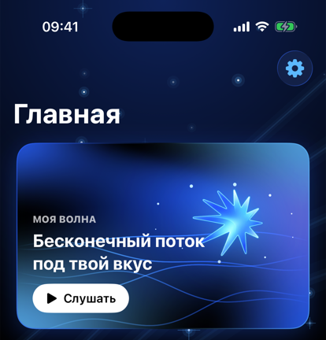
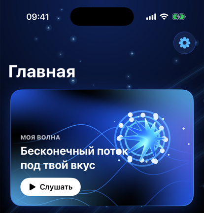
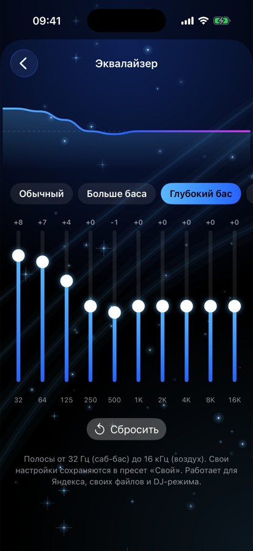
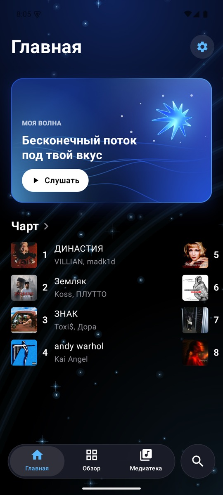
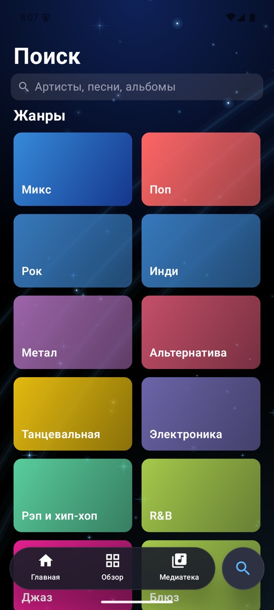
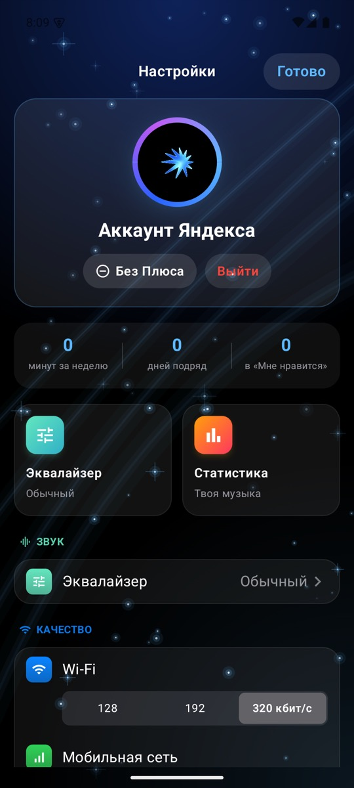
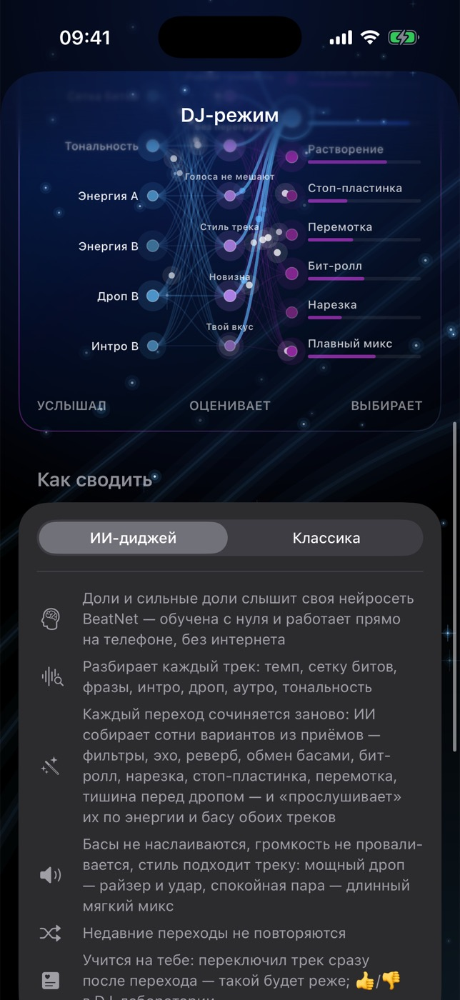

<div align="center">


# Yokayo Music

**Открытый клиент Яндекс Музыки в стиле Apple Music — с ИИ-диджеем, который сводит треки прямо на телефоне**

[](https://github.com/ghostik707/yokayo-music/releases/latest)
[](#-установка)
[](android)
[](ios)
[](LICENSE)

[**⬇️ IPA для iPhone**](https://github.com/ghostik707/yokayo-music/releases/latest) · [**🤖 APK для Android**](https://github.com/ghostik707/yokayo-music/releases/latest) · [**🌐 Сайт**](https://ghostik707.github.io/yokayo-music/) · [**🧠 BeatNet**](#-beatnet--своя-нейросеть)

</div>

<p align="center">
  
  &nbsp;
  
  &nbsp;
  
</p>

---

## ✨ Возможности

<table>
<tr>
<td width="50%" valign="top">

### 🎛️ ИИ-диджей
Треки сводятся в непрерывный сет, и каждый переход ИИ сочиняет заново. Он перебирает сотни вариантов: фильтры, эхо, реверб, обмен басами, бит-ролл, нарезку, стоп-пластинку, перемотку, тишину перед дропом. Каждый вариант «прослушивается» по энергии и басу обоих треков. ИИ учится на твоих скипах и оценках 👍/👎.

</td>
<td width="50%" valign="top">

### 🌊 Живая «Моя волна»
Карточка дышит в такт музыке, а при нажатии разлетается неоновыми волнами. Каждый запуск открывает новую сессию волны.

</td>
</tr>
<tr>
<td valign="top">

### 🎚️ Звук
Эквалайзер на 10 полос с пресетами и своим профилем. Ровная громкость −14 LUFS, кроссфейд, Sped up и Slowed + reverb. Качество задаётся отдельно для Wi‑Fi и мобильной сети.

</td>
<td valign="top">

### 🎤 Тексты караоке
Синхронные тексты с заливкой слов. Карточку со строкой можно сохранить для сторис.

</td>
</tr>
<tr>
<td valign="top">

### 📁 Своя музыка
Файлы MP3, FLAC, M4A и WAV из «Файлов». Свои плейлисты и добавление треков в плейлисты Яндекса.

</td>
<td valign="top">

### 📱 Система
Виджеты, Пункт управления, Siri и «Команды», обложка на весь экран блокировки, таймер сна, статистика прослушивания.

</td>
</tr>
</table>

## 🤖 Android

Та же Yokayo на Kotlin и Jetpack Compose: дизайн один в один с iPhone, «Моя волна», чарт, поиск, тексты, эквалайзер и **ИИ-диджей** со своим звуковым движком (две деки, фильтры, эхо, реверб, подстройка темпа). BeatNet на Android даёт те же результаты, что на iPhone.

<p align="center">
  
  &nbsp;
  
  &nbsp;
  
</p>

## 🎛️ TransitionNet — нейросеть сама рисует переход

Вторая своя нейросеть Yokayo. На каждую из 32 долей перехода она получает бас, середину и верх обоих треков, темп, тональность, есть ли дроп — и случайный «вектор настроения». А отдаёт не номер шаблона, а сами движения ручек: **13 кривых** — громкость, бас, середину, ВЧ- и НЧ-фильтры, эхо и реверб обеих дек.

```
бас/середина/верх A и B по долям ─┐
темп, тональность, дроп ──────────┼─▶ 6 расширяющихся свёрток ─▶ 13 кривых × 32 доли
случайное «настроение» z ─────────┘        (≈58 тыс. параметров)
```

- **Учится в две фазы:** сначала на шаблонах диджеев (обмен басами, фильтры, эхо, растворение, кроссфейд), потом сама — по «судье»: басы не спорят, громкость не проваливается, голоса не мешают, оба трека не орут вместе, резкие смены — только на сильную долю.
- **Не повторяется:** разные «настроения» дают разные переходы; на каждый переход сеть рисует 12 вариантов, «судья» берёт лучший, похожие на недавние отбрасываются.
- **Переключатель в DJ-настройках:** «Композитор» (переход собирается из приёмов) или «TransitionNet» (переход рисует нейросеть). Биты в обоих режимах слышит BeatNet.
- **«Как думает ИИ»** в DJ-лаборатории на iPhone: нейроны, связи и бегущие импульсы — что сеть услышала, её «настроение» и какие ручки она крутит.

<p align="center"></p>

Веса — [`ios/YokayoMusic/Audio/TransitionNet.bin`](ios/YokayoMusic/Audio/TransitionNet.bin), работает на iPhone и на Android.

## 🧠 BeatNet — своя нейросеть

Чтобы сводить по битам, нужно точно знать, где они. BeatNet — маленькая свёрточная сеть, обученная с нуля специально для Yokayo.

```
спектр 24 полосы ─▶ 8 расширяющихся свёрток ─▶ доли + сильные доли ─▶ темп и сетка тактов
                    (слышит ~12 с вокруг)
```

| | |
|---|---|
| Параметров | ≈ 31 тыс. |
| Анализ трека | ≈ 0,5 с на iPhone |
| Где работает | целиком на устройстве, через Accelerate |
| Веса | [`ios/YokayoMusic/Audio/BeatNet.bin`](ios/YokayoMusic/Audio/BeatNet.bin) |

Если сеть не уверена в сетке, она так и говорит. Тогда диджей не сводит по битам и меняет трек через эхо.

## 📦 Установка

**iPhone:** скачайте `YokayoMusic-x.y.ipa` из [последнего релиза](https://github.com/ghostik707/yokayo-music/releases/latest) и установите через **eSign**, **AltStore** или **Sideloadly**.

**Android:** скачайте `YokayoMusic-x.y.apk` из [релизов](https://github.com/ghostik707/yokayo-music/releases), откройте файл и разрешите установку. Android 8+.

Затем войдите в аккаунт Яндекса. Для полных треков нужна подписка Яндекс Плюс.

## 🛠️ Сборка

```bash
git clone https://github.com/ghostik707/yokayo-music.git
open yokayo-music/ios/YokayoMusic.xcodeproj
```

Android: `cd android && ./gradlew assembleRelease` (JDK 17, Android SDK 35).

iPhone: нужен Xcode 26+. Зависимость [YM-API](https://github.com/p0rterB/YM-API) подтянется через Swift Package Manager. Соберите схему `YokayoMusic`.

## 🗂️ Структура

```
ios/        приложение для iPhone — SwiftUI, AVAudioEngine, виджеты
android/    версия для Android
docs/       сайт проекта (GitHub Pages)
```

## ⚖️ Дисклеймер

Yokayo Music — неофициальный клиент. Он не связан с Яндексом и Apple. Музыка воспроизводится по вашей подписке. В репозитории нет треков, взломов и обходов подписки, а приложение обращается только к серверам Яндекс Музыки.

## 📄 Лицензия

[MIT](LICENSE). Библиотека YM-API распространяется под своей лицензией (LGPL).

<div align="center"><sub>Сделано с любовью к музыке 💙</sub></div>
